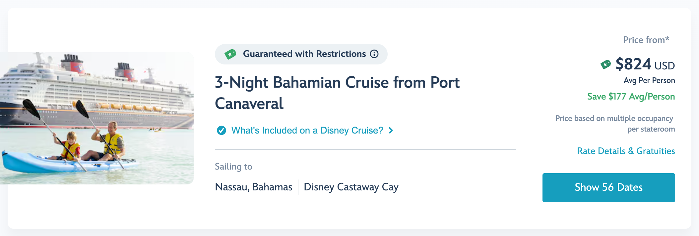
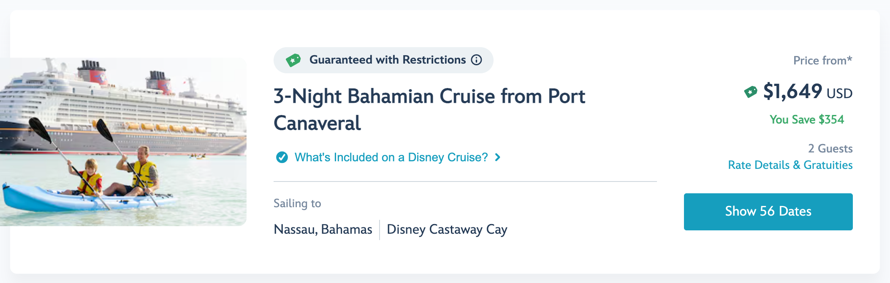

# DCL Total Prices

***AI Transparency*** - This project was created on October 21st, 2026 using Claude Code. All users can view the code and configuration for it here in this repo. There are no scripts or code that runs on your computer or web browser. Please see the sections below for more technical details.

## About 

A tiny Chrome extension that keeps Disney Cruise Line prices shown as the **total price for your stateroom** instead of an average per person.

## Before and after

**Without the extension:** the total flashes on screen for a moment, then the page rewrites it as a per-person average.

**With the extension:** the page keeps the total it originally loaded.

## Why this happens

Disney Cruise Line is running an A/B test on its booking site. Visitors are randomly placed into groups, and some groups see per-person averages instead of totals. That's why you may see one thing and a friend sees another.

The page first loads with normal total prices. About a second later, a response from Adobe Target (the A/B testing service the site uses) arrives with a script for the test `DPO-16855 · Expose Avg Price per Person in Sales Flow`. That script divides each price by the number of guests in your party and rewrites:

- sailing cards on the search results page
- the cruise details summary
- stateroom type cards
- deck cards

## How the extension fixes it

The extension contains one network rule ([rules.json](rules.json)). The rule blocks requests to Adobe Target, but only when they come from `disneycruise.disney.go.com`. The test script never reaches the page, so the page keeps the totals it already loaded.

- The extension doesn't run any code on Disney's pages and doesn't read or change page content.
- It collects no data and makes no network requests of its own.
- Adobe Target keeps working on every other website.

**Side effect:** the extension turns off all Adobe Target tests and personalization on the Disney Cruise Line site, not just this one. Prices and search results load from Disney's own servers, so they aren't affected.

## Install

The extension isn't on the Chrome Web Store, so load it manually:

1. Download or clone this folder.
2. In Chrome, go to `chrome://extensions`.
3. Turn on **Developer mode** (top right).
4. Click **Load unpacked** and select this folder.
5. Reload any open Disney Cruise Line tabs.

This also works in other Chromium browsers such as Edge, Brave and Arc.

To turn it off, switch it off or remove it on the same `chrome://extensions` page.

## Troubleshooting

If prices still switch to per-person with the extension on, Disney may have moved the test to a different service, or made per-person pricing the site default. Please open an issue and say which page it happened on.

## Disclaimer

This is an unofficial project, not affiliated with or endorsed by Disney. "Disney Cruise Line" is a trademark of Disney. The screenshots show the site as it looked on October 21, 2026, and prices change all the time.

## License

[MIT](LICENSE)
